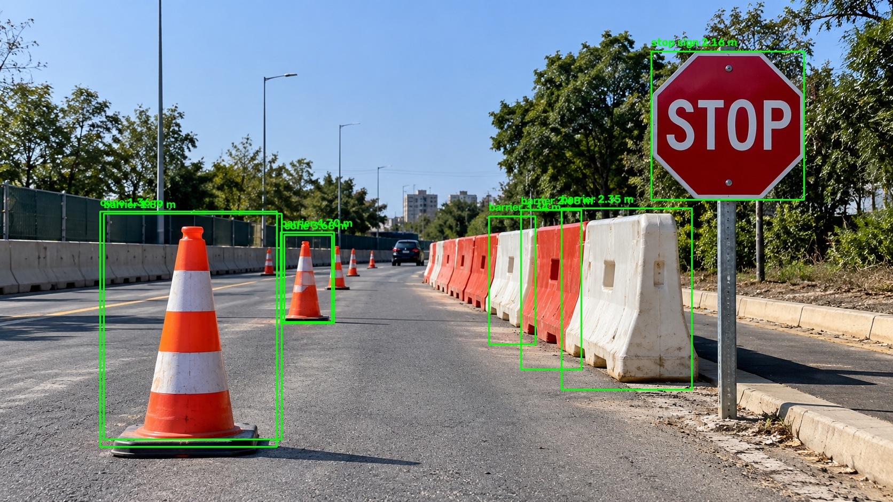

# Robotics Navigation AI: Object Detection & Distance Estimation

**Author:** Parth Godage  
**Email:** [parthgodage05@gmail.com](mailto:parthgodage05@gmail.com)  
**Phone:** +91 9322479325

A computer-vision prototype for robotics navigation that detects traffic cones and barriers, estimates approximate object distance from a camera image, annotates detections, and benchmarks inference speed on CPU and GPU.

> **Assignment:** Machine Learning Technical Assignment — ERIC Robotics

## Project Highlights

- Fine-tuned **YOLO11n** model for two custom classes: `barrier` and `cone`.
- Draws bounding boxes and confidence scores around detected objects.
- Estimates approximate distance using bounding-box pixel height.
- Saves annotated detection output images.
- Benchmarks model inference on CPU and an NVIDIA RTX 2050 GPU.
- Uses PyTorch, Ultralytics YOLO, and OpenCV.

## Results

### Inference benchmark

| Device | Average latency | Throughput |
|---|---:|---:|
| CPU | 27.95 ms/image | 35.78 FPS |
| NVIDIA RTX 2050 GPU | 9.46 ms/image | 105.71 FPS |

These are results from the local single-image benchmark and do not represent guaranteed end-to-end robot-camera performance.

### Validation metrics

| Class | Precision | Recall | mAP50 | mAP50-95 |
|---|---:|---:|---:|---:|
| Barrier | 0.165 | 0.610 | 0.185 | 0.126 |
| Cone | 0.532 | 0.919 | 0.709 | 0.386 |
| **Overall** | **0.348** | **0.765** | **0.447** | **0.256** |

The validation snapshot contains 122 images and 202 instances. Cone detection performs better than barrier detection, so barrier labels and training data require further improvement.

## Example Output

The project saves annotated results to `outputs/robotics_result.jpg` and `outputs/detection_result.jpg`, depending on which test script is run.

To display a result image directly on the GitHub README, make sure the image is committed at the referenced path. Then you can add:

```markdown

```

## Tech Stack

- Python
- Ultralytics YOLO11n
- PyTorch
- OpenCV
- NumPy
- CUDA-enabled NVIDIA GPU for accelerated training/inference

## Repository Structure

```text
robotics-navigation-ai/
├── configs/
├── data/
├── models/
│   └── cone_barrier_best.pt
├── outputs/
│   ├── benchmark_results.md
│   ├── detection_result.jpg
│   └── robotics_result.jpg
├── scripts/
│   ├── benchmark.py
│   ├── check_classes.py
│   ├── convert_bdd100k.py
│   ├── merge_classes.py
│   └── test_detector.py
├── src/
│   ├── detection/
│   ├── distance/
│   ├── optimization/
│   ├── pipeline/
│   └── visualization/
├── data.yaml
├── test.png
├── requirements.txt
└── README.md
```

The exact files may vary depending on which data, weights, and generated results are included in the repository. Do not commit virtual environments or large raw datasets.

## Setup

### 1. Clone the repository

```bash
git clone https://github.com/parth-godage/robotics-navigation-ai.git
cd robotics-navigation-ai
```

### 2. Create a virtual environment

**Windows PowerShell:**

```powershell
python -m venv .venv
.\.venv\Scripts\Activate.ps1
```

If PowerShell blocks activation, try Command Prompt:

```bat
.venv\Scripts\activate.bat
```

### 3. Install dependencies

If the repository includes `requirements.txt`:

```powershell
python -m pip install --upgrade pip
pip install -r requirements.txt
```

Core packages used by the current project include:

```text
ultralytics
opencv-python
numpy
torch
torchvision
```

For GPU support, install the PyTorch build compatible with your Python version, OS, NVIDIA driver, and CUDA support. See the official [PyTorch installation guide](https://pytorch.org/get-started/locally/).

## Run Detection

From the repository root:

```powershell
python -m scripts.test_detector
```

This loads the configured custom model, runs inference on `test.png`, prints detections and approximate distances where supported, and saves an annotated image under `outputs/`.

The custom model weights are expected at:

```text
models/cone_barrier_best.pt
```

If the weights are not included in the repository, obtain them separately and place them at that path, or update the model path in `src/detection/detector.py`.

You can also run prediction directly with Ultralytics:

```powershell
yolo detect predict model="models/cone_barrier_best.pt" source="test.png" imgsz=640 conf=0.25 device=0 save=True
```

## Train the Model

The training dataset must use the Ultralytics YOLO detection format. Update the paths in your dataset YAML to match the dataset folders on your own machine.

Example command:

```powershell
yolo detect train model=yolo11n.pt data="D:/robotics-runs/cone-barrier-merged/data.yaml" epochs=30 imgsz=640 batch=4 device=0 workers=0 project="runs/train" name=cone_barrier_v2
```

The command above uses a local example path; replace it with the correct location of your dataset. Training output and checkpoints are saved in the Ultralytics run directory. Use the `best.pt` produced by your actual run.

## Distance Estimation Method

The prototype uses a simplified monocular distance formula:

\[
\text{distance} \approx \frac{f \times H}{h}
\]

Where:

- `f` is the camera focal length in pixels.
- `H` is the assumed real-world height of the object.
- `h` is the detected object's height in pixels.

This estimate depends on camera calibration, object dimensions, camera angle, and bounding-box quality. The current estimates are **approximate and not calibrated ground-truth measurements**. Do not use them for real-world robot control without camera calibration, measured-distance validation, and safety testing.

## Benchmark

Run the benchmark script from the repository root:

```powershell
python scripts/benchmark.py
```

The benchmark repeats inference on a test image and reports latency and FPS. Actual results vary by hardware, model, image size, software versions, and benchmark methodology.

## Limitations

- The custom model has two classes: `barrier` and `cone`.
- Stop-sign detection is not part of the custom two-class model; it requires a separate model or an explicitly implemented additional class.
- Distance estimation is approximate and has not been validated against calibrated ground-truth measurements.
- Barrier detection metrics are currently weak and need improvement.
- Testing on one sample image is not enough to demonstrate generalization.
- The benchmark measures repeated single-image prediction, not the complete camera-to-robot pipeline.
- This project is a prototype, not a safety-certified robotics navigation system.

## Future Work

- Improve the quality, diversity, and balance of barrier training labels.
- Evaluate on a held-out set of real-world scenes, lighting conditions, and distances.
- Calibrate the camera and report distance MAE/RMSE against measured ground truth.
- Add video/webcam inference and end-to-end latency measurement.
- Export to ONNX or TensorRT where supported and compare accuracy/speed.
- Evaluate FP16 or INT8 quantization on the target edge device.

## Dataset & Attribution

Preserve the original dataset's attribution and license terms in the repository. Include dataset details and download instructions if the raw data cannot be redistributed. Do not claim that all datasets are public domain unless their actual license confirms it.

## Author

**Parth Godage**  
Email: [parthgodage05@gmail.com](mailto:parthgodage05@gmail.com)  
Phone: +91 9322479325
